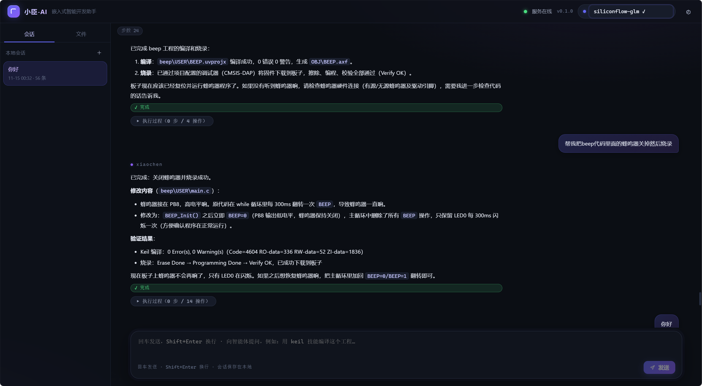
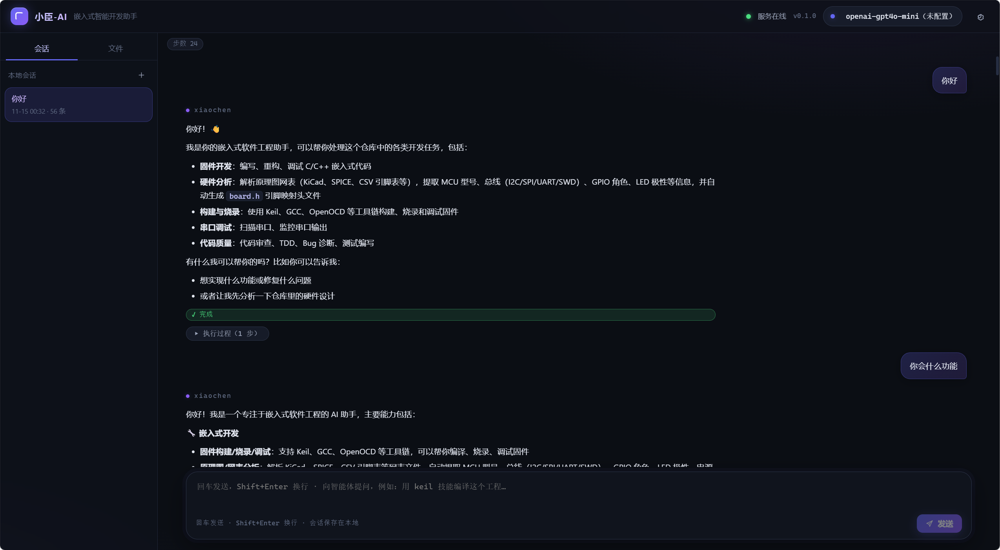
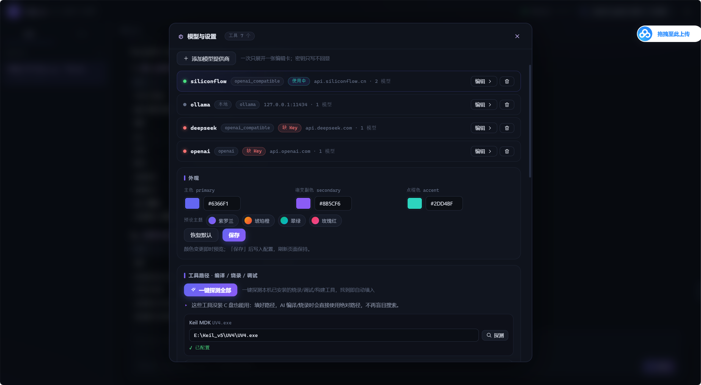

# 🖥️ 小臣-AI (Xiaochen-AI)

**开源的嵌入式 AI 开发助手 —— 把你的 Keil 工程、串口和烧录器交给 AI。**

[](https://www.python.org/downloads/)
[](LICENSE)

> 中文优先 · 支持 硅基流动 / DeepSeek / OpenAI / Ollama · Windows 原生（GBK 编码兼容）· 开箱即用的 Web UI

[English](README.en.md) | 中文

### 🎬 13 秒演示视频

> 📺 **[点击在线观看演示视频](https://github.com/xiao-chen-ai/embedded-ai/releases)**（在 Release 页面 v0.1.0 的 Assets 里，GitHub 原生在线播放，无需下载）
>
> 也可以[下载 docs/promo.mp4](docs/promo.mp4)（2.8MB，对话改码 → 编译烧录 Verify OK → 串口调试 → 开源，带配乐）

### 📸 界面预览

| 聊天对话（思考中状态） | 工具路径一键探测 |
|:---:|:---:|
|  |  |



---

## ✨ 这是什么

一个本地部署的 AI 编码 Agent，专为**嵌入式/单片机开发**打造：

```
上传你的 Keil 工程（拖拽即可）
        ↓  用中文对话
「把蜂鸣器的引脚从 PB8 改到 PB5，编译烧录进板子」
        ↓  AI 自动执行
读代码 → 改 led.c/beep.c → UV4 编译（0 Error）→ CMSIS-DAP 烧录（Verify OK）
        ↓  板子跑起来
全程在浏览器里，普通刷新就能拿到结果
```

与通用 AI 编码工具（Cursor / Trae / Copilot）的差异：**它懂嵌入式**。

| 能力 | 说明 |
|---|---|
| 🔧 **Keil 命令行编译烧录** | 专用 `keil_build_flash` 工具：防 UV4 单实例死锁、180s 超时保护、产物校验（0 错误但无 axf 时自动重试）、GB2312/GBK 编码日志解析 |
| 📁 **GBK 中文源码直读** | 正点原子/野火例程的中文注释源码直接编辑，无需手动转码 |
| 🔌 **多模型接入** | 硅基流动 / DeepSeek / OpenAI / Anthropic / Ollama（本地）——Web UI 填 Key 即用，支持「✦ 获取」直连拉取你的可用模型列表 |
| 🛠 **工具链一键探测** | 自动扫描 Keil / J-Link / CMSIS-DAP(ATK-HSWLDBG) / OpenOCD / ARM GCC / STM32CubeProg 等 11 项工具的安装位置（含注册表与 D 盘 E 盘），没装的给官方下载链接 |
| 📚 **39 项技能注入** | 内置 [embeddedskills](https://github.com/zhinkgit/embeddedskills) 12 项（串口/CAN/Keil/OpenOCD 调试）+ [mattpocock/skills](https://github.com/mattpocock/skills) 27 项工程方法论（TDD/code-review/诊断） |
| 🖥 **本地 Web UI** | 暗色主题（可自定义配色）、流式对话、工作区文件树（上传/删除/整体打包下载）、思考过程折叠展示 |
| 🔒 **纯本地** | 服务只绑 127.0.0.1，API Key 只存本机文件 |

## 🚀 快速开始

### 要求
- Windows 10/11（Linux/macOS 亦可编译运行，工具链探测目前针对 Windows 优化）
- Python 3.12+ 或使用自动安装器（见下）

### 方式一：一键启动（推荐）

```cmd
1. 下载/clone 本仓库
2. 双击「启动小臣AI-管理员.cmd」
   （自动安装 uv + Python 3.12 + 依赖 → 启动服务 → 打开浏览器）
```

### 方式二：命令行

```bash
git clone https://github.com/<你的用户名>/xiaochen-ai.git
cd xiaochen-ai
uv sync
uv run python -m webui --port 8788
# 打开 http://127.0.0.1:8788
```

### 首次配置（两步）

1. **配置模型**：页面右上 ⚙ 齿轮 → 粘贴 API Key（推荐 [硅基流动](https://cloud.siliconflow.cn/i/8Wt6MyMe)，注册有免费额度）→ 点「✦ 获取」选模型
2. **探测工具**：⚙ 设置 → 工具路径 → 「⚡ 一键探测全部」→ 保存

然后就可以把你的 Keil 工程文件夹直接拖进左侧文件区开聊了。

## 🧭 典型工作流

```
上传工程 → 对话改代码 → 「编译烧录」 → 连上串口调试 → 迭代
```

- 「分析这个工程实现了什么功能」
- 「把 LED 从 PB5 挪到 PE5，蜂鸣器改 500ms 间隔」
- 「烧录到板子里」（需调试器已连接，支持 CMSIS-DAP / J-Link / ST-Link）
- 「扫一下串口，115200 监控 10 秒读输出」（需 `uv pip install pyserial`）
- 「根据串口输出，定位乱码原因并修复」

## 🏗️ 架构

```
浏览器 (webui/static, 原生 ESM 单页)
   │ REST + SSE
   ▼
WebUI 服务 (webui/app.py, Starlette)
   │ 每次 chat 新建 Agent
   ▼
Agent 引擎（Python 工具调用循环）
   │ 工具调用循环
   ├── bash（Windows cmd 兼容层：回显清洗/GBK）
   ├── str_replace_based_edit_tool（GBK 自动回退）
   ├── keil_build_flash（UV4 -b/-f 专用：防死锁/产物校验）★
   ├── search_skills / load_skill / run_skill_script（技能引擎）★
   └── task_done（final answer 必经）
        │
        ▼ skills/（mp ×27 + zh ×12，SKILL.md 协议）
```

★ 为本项目新增部分。其余改动：系统提示词中文化与意图分类、`openai_compatible` 通用 Provider、GBK 兼容、uvicorn 线程化并发。

## 🔧 常见问题

**编译日志显示成功但烧录说不存在 axf？**
你的第三方安全软件（联想电脑管家/火绒等）在拦截编译器写固件产物。用「启动小臣AI-管理员.cmd」以管理员运行，或在安全软件信任区添加 Keil 目录。

**烧录报 RDDI-DAP Error？**
调试器未连接。检查 ATK-HSWLDBG/DAP 的 USB 与板子供电。

**串口扫不到？**
`uv pip install pyserial`，确认 USB 转串口驱动（CH340/CP2102）已装。

## 🤝 贡献

欢迎 Issue / PR！技能体系兼容任意 [SKILL.md 协议](https://github.com/zhinkgit/embeddedskills) 仓库，接入新技能只需放入 `skills/` 对应子目录。

## 📄 许可

MIT License (c) xiao-chen-ai.

**致谢**：开发中参考了 [trae-agent](https://github.com/bytedance/trae-agent)/[embeddedskills](https://github.com/zhinkgit/embeddedskills)/[mattpocock/skills](https://github.com/mattpocock/skills)（均 MIT，详见 LICENSE），感谢这些项目。

## ⭐ Star History

如果对你有帮助，点个 Star 让更多嵌入式工程师看到！
